# EcoRAEE Cloud · Arquitectura AWS con SQL Server

Este documento explica los diagramas de la carpeta `diagramas/` y las políticas de la carpeta `iam/`.
Cada diagrama está en dos formatos: `.drawio` (se abre y edita en draw.io / diagrams.net) y `.png`.
Al final de cada sección está la versión en **Mermaid (flowchart)** por si la necesitan en el informe o en GitHub.

| Archivo | Qué muestra |
|---|---|
| `diagramas/Arquitectura_AWS` | La arquitectura completa (VPC con subredes públicas y privadas en 2 zonas, IGW, ALB, NAT por zona, Auto Scaling, RDS SQL Server, S3 privado) |
| `diagramas/Inicio_sesion` | Cómo inicia sesión un usuario de la app (JWT) |
| `diagramas/Ciclo_de_vida` | Estados del dispositivo y de solicitud, movimiento y transferencia |
| `diagramas/Flujo_maximo` | Red del escenario ESC-1 con flujo/capacidad y corte mínimo |
| `diagramas/Politicas_IAM_EC2` | Rol de la EC2, sus 4 políticas y las demás políticas corregidas |
| `iam/*.json` | Las políticas listas para pegar en la consola de IAM |
| `flujo_maximo.py` | Edmonds-Karp en Python (el mismo que usaría la API) |

> En los JSON, reemplacen `ACCOUNT_ID` y `KMS_KEY_ID` por los valores reales de su cuenta.
> **Nunca** pongan access keys ni contraseñas en el repositorio.

---

## 1. Cómo usar SQL Server en AWS

En AWS, SQL Server se usa con **Amazon RDS for SQL Server**. RDS es un SQL Server administrado: AWS instala el motor, saca los backups y aplica parches; ustedes solo crean la base y ejecutan sus scripts.

### 1.1 Qué crear y con qué opciones

| Opción en la consola de RDS | Valor | Por qué |
|---|---|---|
| Motor | Microsoft SQL Server, **Express Edition**, *License included* | Express no cobra licencia. Es la más barata para el proyecto. |
| Clase | **db.t3.micro**, Single-AZ | Alcanza para el MVP y entra en la capa gratuita el primer año. |
| Credenciales | *Manage master credentials in AWS Secrets Manager* | La contraseña la genera y guarda AWS. Nadie la escribe en el código. |
| Red | La VPC `ecoraee-vpc`, *DB subnet group* con las 2 subredes privadas de BD | RDS exige un subnet group en 2 zonas, aunque la instancia viva en una. |
| Acceso público | **No** | La base nunca se expone a internet. |
| Security group | `SG-DB`: entrada TCP **1433** solo desde `SG-API` | Solo las EC2 de la API pueden conectarse. |
| Almacenamiento | 20 GB gp3, cifrado con KMS | Mínimo de RDS. Cifrado en reposo. |
| Backups | Automáticos, 7 días | Permite restaurar a cualquier minuto de la última semana. |

**Límites de Express que deben mencionar en el informe:**
- **No tiene Multi-AZ.** La disponibilidad de la base se justifica con backups automáticos y snapshots (RPO de unos 5 minutos, RTO de lo que tarde restaurar, unos 20 a 30 minutos). Si necesitaran Multi-AZ, tendrían que pasar a **Standard**, que es bastante más cara.
- Máximo 10 GB por base de datos y poca memoria. Para el proyecto sobra.
- No trae SQL Server Agent. Nuestro esquema no lo necesita (los triggers y procedimientos no dependen de él).

> Si usan **AWS Academy Learner Lab**, revisen que RDS for SQL Server esté habilitado en su laboratorio. Si no lo está, el diseño queda igual y lo explican como "diseño objetivo".

### 1.2 Cómo ejecutar los scripts en RDS

RDS no tiene escritorio remoto. La base está en una subred privada, así que desde su computadora no se llega directo. Hay dos formas seguras:

**Opción A (recomendada): túnel con Session Manager desde su PC y SSMS.**
1. Instalen AWS CLI y el *Session Manager plugin*.
2. Abran el túnel a través de una EC2 de la API (no se abre ningún puerto en internet):
   ```bash
   aws ssm start-session --target i-XXXXXXXX \
     --document-name AWS-StartPortForwardingSessionToRemoteHost \
     --parameters host=<endpoint-de-RDS>,portNumber=1433,localPortNumber=1433
   ```
3. En SQL Server Management Studio conéctense a `localhost,1433` con el usuario maestro (lo ven en Secrets Manager).
4. Ejecuten en orden: `01_esquema_sin_borrar.sql`, `02_datos.sql` y `03_pruebas.sql`.

**Opción B: desde la EC2 con `sqlcmd`.** Entren con Session Manager, instalen `mssql-tools18` y ejecuten
`sqlcmd -S <endpoint>,1433 -U admin -C -i 01_esquema_sin_borrar.sql`.

Usen `01_esquema_sin_borrar.sql` en RDS: la primera vez no hay nada que borrar, y así se evita el `ALTER DATABASE ... SINGLE_USER`.

### 1.3 Usuario de la aplicación (mínimo privilegio)

La API **no** debe usar el usuario maestro. Creen un login propio y guarden su contraseña en Secrets Manager como `ecoraee/rds/app`:

```sql
CREATE LOGIN app_api WITH PASSWORD = '<la genera Secrets Manager>';
GO
USE ECORAEE;
CREATE USER app_api FOR LOGIN app_api;
GRANT EXECUTE ON SCHEMA::dbo TO app_api;           -- todos los procedimientos sp_*
GRANT SELECT  ON SCHEMA::dbo TO app_api;           -- vistas y consultas
GRANT INSERT  ON solicitud TO app_api;             -- registrar solicitudes y dispositivos
GRANT INSERT  ON lote TO app_api;
GRANT INSERT  ON dispositivo TO app_api;
GRANT INSERT  ON evidencia TO app_api;
GRANT INSERT  ON auditoria TO app_api;             -- logins exitosos y fallidos
-- Sin UPDATE ni DELETE directos: todo cambio de estado pasa por los procedimientos y sus triggers.
```

### 1.4 Cómo se conecta la API (FastAPI)

En la EC2 se instala el **ODBC Driver 18 for SQL Server** y se usa `pyodbc`. La API lee la contraseña de Secrets Manager al arrancar:

```python
import json, boto3, pyodbc

sec = json.loads(boto3.client("secretsmanager").get_secret_value(SecretId="ecoraee/rds/app")["SecretString"])
conn = pyodbc.connect(
    "DRIVER={ODBC Driver 18 for SQL Server};"
    f"SERVER={sec['host']},1433;DATABASE=ECORAEE;UID={sec['username']};PWD={sec['password']};"
    "Encrypt=yes;TrustServerCertificate=yes;"   # en producción: instalar el certificado CA de RDS y poner "no"
)
cur = conn.cursor()
cur.execute("EXEC sp_recibir_solicitud ?, ?", id_solicitud, id_operador)   # siempre con parámetros "?"
```

---

## 2. Arquitectura

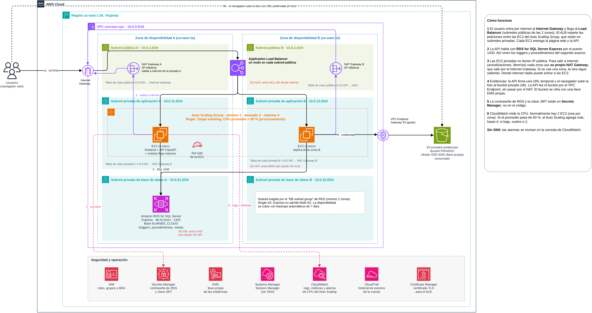

**Recorrido de una petición:**
1. El usuario entra por internet al **Internet Gateway** y llega al **Application Load Balancer** (ALB). El ALB tiene un nodo en la subred pública de cada zona (A y B).
2. El ALB reparte las peticiones entre las EC2 del **Auto Scaling Group**, que están en las subredes privadas de aplicación (normalmente una en cada zona). Cada EC2 entrega la página web y la API (FastAPI + módulo de flujo máximo).
3. La API habla con **RDS for SQL Server Express** por el puerto 1433. Ahí viven los triggers, procedimientos y vistas del segundo avance.
4. Las EC2 no tienen IP pública. Para salir a internet (actualizaciones, librerías) cada zona usa **su propio NAT Gateway**, que está en la subred pública de esa zona y sale por el Internet Gateway. Si se cae una zona, la otra sigue saliendo. Desde internet nadie puede entrar a las EC2.
5. Las fotos se suben al bucket privado `ecoraee-evidencias` (cifrado con una **llave KMS propia**) con URL prefirmada. La API lee el bucket por el **VPC Endpoint Gateway de S3**, que no pasa por el NAT.
6. La contraseña de RDS y la clave JWT están en **Secrets Manager**. CloudWatch recibe logs y la métrica de CPU con la que escala el ASG.

**Redes:**

| Subred | Zona A | Zona B | Tabla de rutas |
|---|---|---|---|
| Pública | 10.0.1.0/24 (ALB, NAT Gateway A) | 10.0.2.0/24 (ALB, NAT Gateway B) | `0.0.0.0/0 → Internet Gateway` |
| Privada de aplicación | 10.0.11.0/24 (EC2) | 10.0.12.0/24 (EC2) | A: `0.0.0.0/0 → NAT Gateway A`. B: `0.0.0.0/0 → NAT Gateway B`. Las dos con la ruta del endpoint S3 |
| Privada de base de datos | 10.0.21.0/24 (RDS) | 10.0.22.0/24 (vacía) | Solo local (sin salida a internet) |

La subred de BD de la zona B existe porque RDS exige un *DB subnet group* con 2 zonas, aunque la base sea Single-AZ (Express no admite Multi-AZ).

**Security groups (encadenados):**
- `SG-ALB`: entra 443 y 80 desde internet (`0.0.0.0/0`).
- `SG-API`: entra 8000 solo desde `SG-ALB`.
- `SG-DB`: entra 1433 solo desde `SG-API`.

**Qué cambió respecto a la versión anterior:**

| Elemento | Antes | Ahora | Por qué |
|---|---|---|---|
| Entrada | CloudFront → Internet Gateway → ALB | **Internet Gateway → ALB → EC2** | Corrección del docente. Se quitaron CloudFront y el bucket `ecoraee-frontend`; la EC2 entrega la página y la API |
| NAT Gateway | Uno | **Uno en cada subred pública** | Cada zona sale a internet por su NAT. Si se cae una zona, la otra no pierde salida |
| Auto Scaling | Sin regla visible en el diagrama | **mín 1 · deseado 2 · máx 4, CPU 60 %** | Corrección del docente: el diagrama ahora dice la regla |
| SNS | Avisaba por correo cuando escalaba | **Eliminado** | Observación del docente. Las alarmas se ven en la consola de CloudWatch |
| CloudFormation | Desplegaba el stack | **Eliminado.** Se crea desde la consola | Pedido del equipo. También se borraron las políticas `07` y `09` |
| Tablas de rutas | No aparecían | Dibujadas en cada subred | Se ve que la pública va al IGW y cada privada a su NAT |

**Revisión de las correcciones del docente contra el diagrama anterior.** El diagrama que ya estaba en la carpeta cumplía con: Auto Scaling Group en 2 zonas, Load Balancer, Internet Gateway, subred pública en ambas zonas y NAT Gateway. Lo que faltaba y ahora está: la **regla de escalado**, la entrada directa **IGW → ALB → EC2**, un NAT por zona y quitar SNS.

### 2.1 Costos aproximados

Usamos servicios baratos. Lo único "grande" son los NAT Gateway y el ALB; lo caro de verdad (RDS SQL Server Standard o Multi-AZ, cientos de dólares al mes) se evitó con **Express Single-AZ**.

| Servicio | Qué usamos | Costo aproximado al mes (us-east-1) |
|---|---|---|
| EC2 | 2 t3.micro (hasta 4 al escalar) | 1 gratis el primer año (750 h). La segunda ≈ USD 7,5 |
| Application Load Balancer | 1 | Gratis el primer año (750 h). Luego ≈ USD 16 |
| RDS SQL Server Express | db.t3.micro, Single-AZ, 20 GB | Gratis el primer año (750 h). Luego ≈ USD 20 |
| **NAT Gateway** | 2 (uno por zona) | **≈ USD 0,045 por hora cada uno ≈ USD 65 los dos**, más USD 0,045 por GB |
| S3 | `ecoraee-evidencias` | Centavos (5 GB gratis el primer año) |
| KMS | 1 llave propia | USD 1 |
| Secrets Manager | 2 secretos | USD 0,80 |
| VPC Endpoint Gateway S3, IAM, CloudTrail, ACM, CloudWatch básico | | Gratis |

**Para no gastar de más:** creen los NAT Gateway para la demo y bórrenlos al terminar (liberando sus IP elásticas), pongan el ASG en deseado = 0 cuando no lo usen y configuren **AWS Budgets** con una alerta (Budgets es gratis; avisa por correo sin necesidad de SNS). HTTPS en el ALB necesita un certificado de ACM, que a su vez necesita un dominio propio; si no tienen dominio, la demo se hace por HTTP 80 y en el informe se explica que en producción se usa 443.

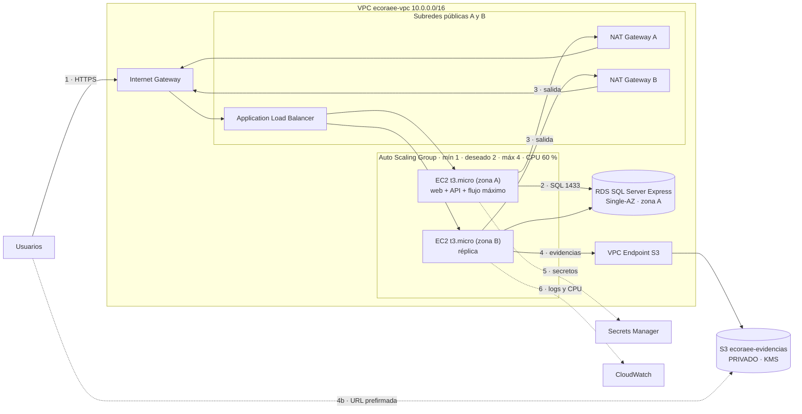

---

## 3. Auto Scaling, explicado sencillo

**Qué es.** Un *Auto Scaling Group* (ASG) es un grupo de servidores EC2 iguales que AWS administra solo. Ustedes le dicen tres números y una regla:

| Configuración | Valor | Qué significa |
|---|---|---|
| Mínimo | 1 | Nunca habrá menos de 1 servidor |
| Deseado | 2 | Normalmente hay 2, una en cada zona |
| Máximo | 4 | Aunque haya mucha carga, no pasa de 4 (controla el costo) |
| Regla | **Target tracking: CPU promedio = 60 %** | Si la CPU sube de 60 %, agrega una EC2. Si baja, la quita |

**Qué regla usamos y por qué.** Hay varias formas de decidir cuándo escalar:

| Regla | Métrica de AWS | Cuándo conviene | ¿La usamos? |
|---|---|---|---|
| **Procesamiento (CPU)** | `ASGAverageCPUUtilization` | Cuando el trabajo pesado es cálculo | **Sí.** El flujo máximo (Edmonds-Karp) y los procedimientos consumen CPU. Es la regla más simple y la que AWS recomienda para empezar |
| Cantidad de solicitudes | `ALBRequestCountPerTarget` (por ejemplo 100 por EC2) | Cuando hay muchas peticiones cortas | Alternativa válida. Se puede agregar como segunda política |
| Usuarios conectados | No existe métrica directa. Se aproxima con solicitudes por EC2 | Apps con sesiones largas | No. Con JWT las EC2 no guardan sesiones, así que se mide por solicitudes |
| Programada | *Scheduled action* | Cuando se sabe la hora de la carga | Opcional: subir a 4 durante la campaña de fin de semestre (ESC-3) |
| Tráfico de red | `ASGAverageNetworkIn/Out` | Apps que mueven muchos archivos | No. Las fotos van directo a S3, no pasan por la EC2 |

**Una analogía.** Es como las cajas de un supermercado. Normalmente hay 2 cajas abiertas. Si se forma una fila larga (la CPU pasa de 60 %), el gerente abre otra caja. Cuando la fila baja, la cierra para no pagar de más. Y si el cajero se enferma, llega otro a reemplazarlo.

**Qué hace en la práctica:**
1. **Reemplaza servidores dañados.** El Load Balancer revisa cada 30 segundos que la API responda (`/health`). Si una EC2 deja de responder, el ASG la termina y crea otra nueva sin que nadie intervenga.
2. **Crece con la demanda.** Por ejemplo, en la campaña de recolección de fin de semestre (escenario ESC-3) muchos usuarios registran equipos al mismo tiempo.
3. **Reparte en 2 zonas.** Si se cae una zona de AWS completa, la otra sigue atendiendo.

**Por qué lo necesitamos.** En el Avance 1 había una sola EC2 sin reemplazo: si fallaba, la app se caía (punto único de fallo, va contra el RNF de disponibilidad). Con el ASG y el Load Balancer, la API sigue funcionando aunque falle un servidor o una zona.

**Qué exige a la aplicación.** Que ningún servidor guarde nada propio:
- La sesión del usuario va en el token JWT, no en la memoria del servidor. Cualquier EC2 puede atender a cualquier usuario.
- Las fotos van a S3, no al disco de la EC2.
- Los datos van a RDS.

**Cómo se crea (desde la consola):**
1. Una *Launch Template*: Amazon Linux 2023, t3.micro, rol `ecoraee-ec2-api-role`, `SG-API`, sin IP pública, y un script de arranque que instala la API.
2. El ASG en las 2 subredes privadas de aplicación, conectado al *target group* del ALB, con *health check* de tipo ELB.
3. Una política *Target tracking* con la métrica *Average CPU utilization* = 60.
4. CloudWatch crea solo las alarmas de esa política. Se ven en la consola (sin SNS).

---

## 4. Inicio de sesión

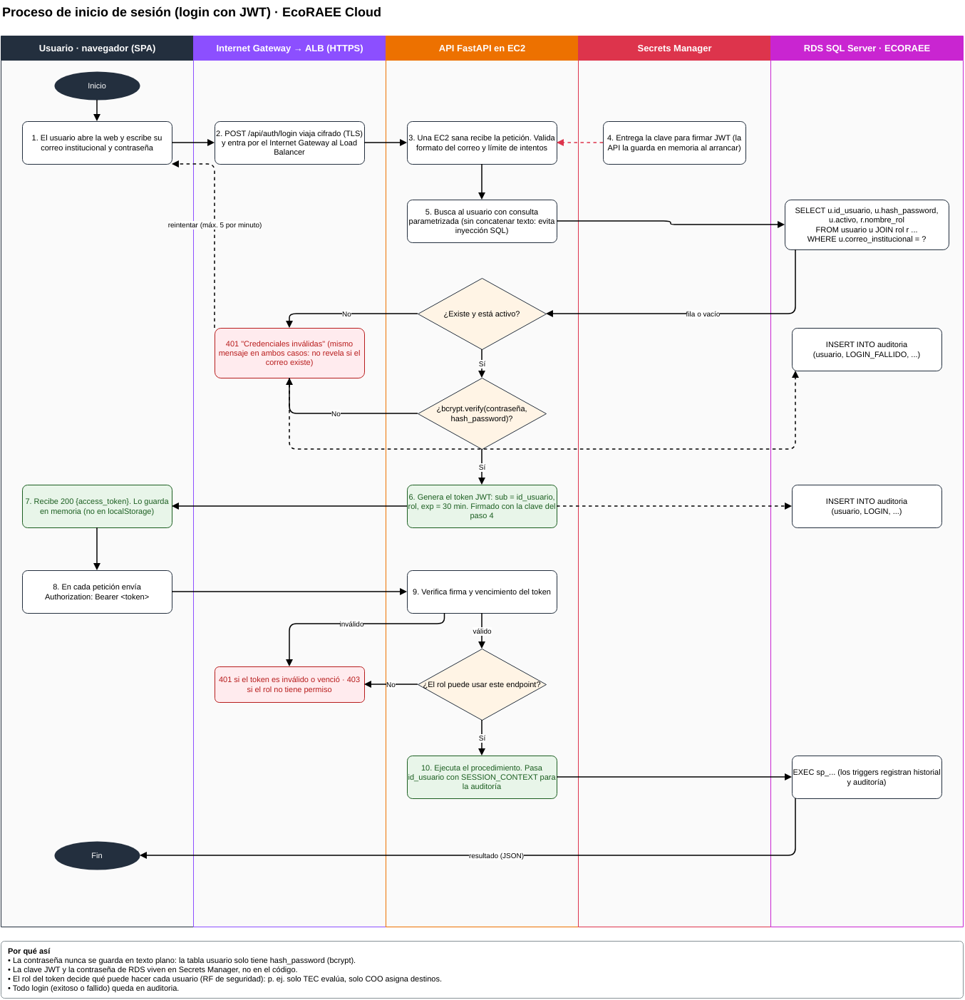

Los usuarios de la app (generador, operador, técnico, coordinador, etc.) **no** son usuarios IAM. IAM es solo para el equipo que administra AWS. La app usa la tabla `usuario` y tokens **JWT**:

1. El usuario escribe correo y contraseña. La SPA envía `POST /api/auth/login` por HTTPS.
2. La API busca al usuario por `correo_institucional`, con una consulta parametrizada.
3. Compara la contraseña con `hash_password` usando **bcrypt**. La contraseña nunca se guarda en texto plano.
4. Si no coincide o el usuario está inactivo, responde **401** con el mismo mensaje en los dos casos y registra `LOGIN_FALLIDO` en `auditoria`. Hay un límite de 5 intentos por minuto.
5. Si coincide, genera un JWT con `sub = id_usuario`, `rol` y vencimiento de 30 minutos, firmado con la clave guardada en Secrets Manager (`ecoraee/jwt/...`).
6. En cada petición siguiente el navegador envía `Authorization: Bearer <token>`. La API verifica la firma, el vencimiento y si el **rol** puede usar ese endpoint (403 si no). Después llama al procedimiento y pasa `id_usuario` por `SESSION_CONTEXT`, para que los triggers registren quién hizo el cambio.

Alternativa: **Amazon Cognito** hace lo mismo como servicio administrado. Lo dejamos con JWT propio porque ya existe la tabla `usuario` con roles y es más fácil de explicar y probar.

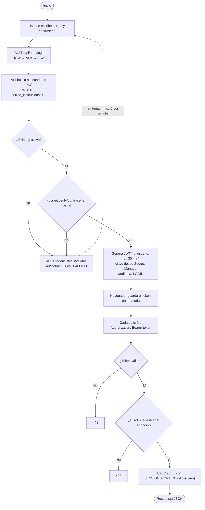

---

## 5. Bucket privado de evidencias

Ya no hay bucket para la página web: la EC2 entrega la página junto con la API. Queda un solo bucket, y es privado.

**Configuración:**
- *Block Public Access*: las 4 opciones activadas.
- *Object Ownership*: *Bucket owner enforced* (sin ACL).
- Política que **rechaza conexiones sin HTTPS** (`aws:SecureTransport = false`).

**`ecoraee-evidencias` (fotos y actas):**
- Cifrado con una **llave KMS propia** (SSE-KMS) y **versionado** activado: si alguien sube un archivo con el mismo nombre, el anterior no se pierde.
- Nadie puede borrar evidencias (`iam/08_...`), porque son la prueba de la trazabilidad (RN-03 y RN-08). Para cambiar esto haría falta editar la política del bucket a propósito.
- **Subida con URL prefirmada:** el navegador pide permiso a la API. La API, con su rol, firma una URL válida por 5 minutos para un solo archivo (`evidencias/<id>.jpg`). El navegador sube la foto directo a S3 con esa URL. Así el bucket sigue privado y la foto no pasa por la EC2.
- La API lee las evidencias por el **VPC Endpoint (Gateway)**, sin salir a internet y sin pagar NAT.

---

## 6. Ciclos de vida (corregidos)

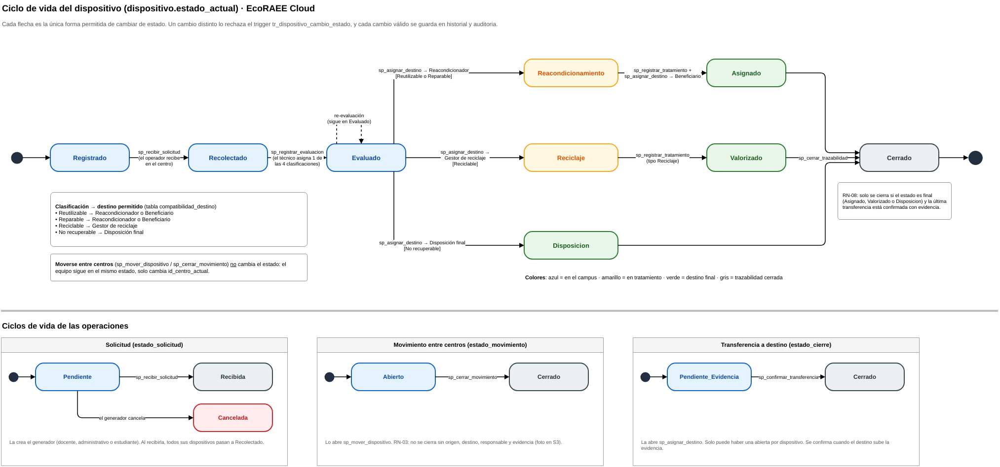

Ahora coinciden exactamente con el `CHECK` y el trigger `tr_dispositivo_cambio_estado` del SQL. Se agregaron **Asignado** y **Valorizado**, y en cada flecha se indica el procedimiento que hace el cambio.

| De | A | Quién lo hace |
|---|---|---|
| (nuevo) | Registrado | El generador crea la solicitud y sus dispositivos |
| Registrado | Recolectado | `sp_recibir_solicitud` |
| Recolectado | Evaluado | `sp_registrar_evaluacion` (una de 4 clasificaciones) |
| Evaluado | Reacondicionamiento | `sp_asignar_destino` a un Reacondicionador (Reutilizable o Reparable) |
| Evaluado | Reciclaje | `sp_asignar_destino` a un Gestor de reciclaje (Reciclable) |
| Evaluado | Disposicion | `sp_asignar_destino` a Disposición final (No recuperable) |
| Reacondicionamiento | **Asignado** | `sp_registrar_tratamiento` y luego `sp_asignar_destino` a un Beneficiario |
| Reciclaje | **Valorizado** | `sp_registrar_tratamiento` (tipo Reciclaje) |
| Asignado, Valorizado o Disposicion | Cerrado | `sp_cerrar_trazabilidad` (RN-08: última transferencia confirmada) |

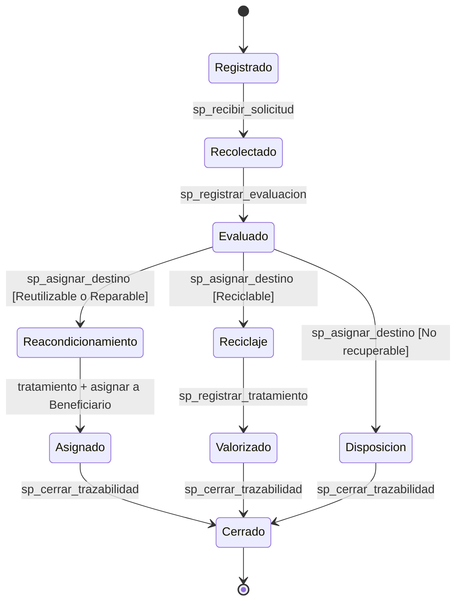

Versión flowchart, por si su herramienta no soporta `stateDiagram`:

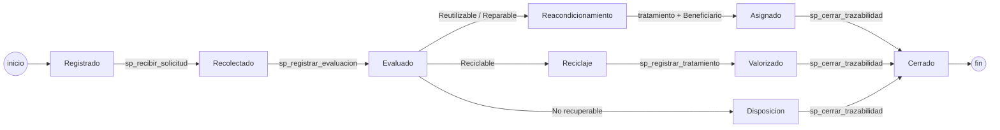

Las otras entidades también tienen su ciclo:
- **Solicitud:** Pendiente → Recibida (o Cancelada).
- **Movimiento:** Abierto → Cerrado. No se cierra sin evidencia (RN-03).
- **Transferencia:** Pendiente_Evidencia → Cerrado.

---

## 7. Flujo máximo: qué es

**La idea.** Imaginen la red de recolección como tuberías. Los campus generan equipos (la *fuente*, S), que pasan por los centros de acopio y el laboratorio y terminan en los destinos (el *sumidero*, T). Cada tramo tiene una **capacidad**: cuántos kg por semana puede mover como máximo. El **flujo máximo** responde a una pregunta: *¿cuántos kg por semana, como máximo, pueden llegar desde los campus hasta un destino final sin pasar la capacidad de ningún tramo?*

**Reglas que cumple un flujo:**
1. En ningún tramo pasa más que su capacidad (0 ≤ flujo ≤ capacidad).
2. Todo lo que entra a un centro sale de él (conservación). Ningún centro "fabrica" ni "pierde" kg.

**Cómo lo calcula Edmonds-Karp.**
1. Buscar con **BFS** el camino más corto de S a T que todavía tenga espacio libre.
2. Enviar por ese camino lo máximo que permita su tramo más angosto (el *cuello de botella*).
3. Repetir hasta que no quede ningún camino con espacio libre.

**Resultado del escenario base (ESC-1):** encontró 6 caminos y el flujo máximo es **140 kg/semana**, aunque los campus generan 200.

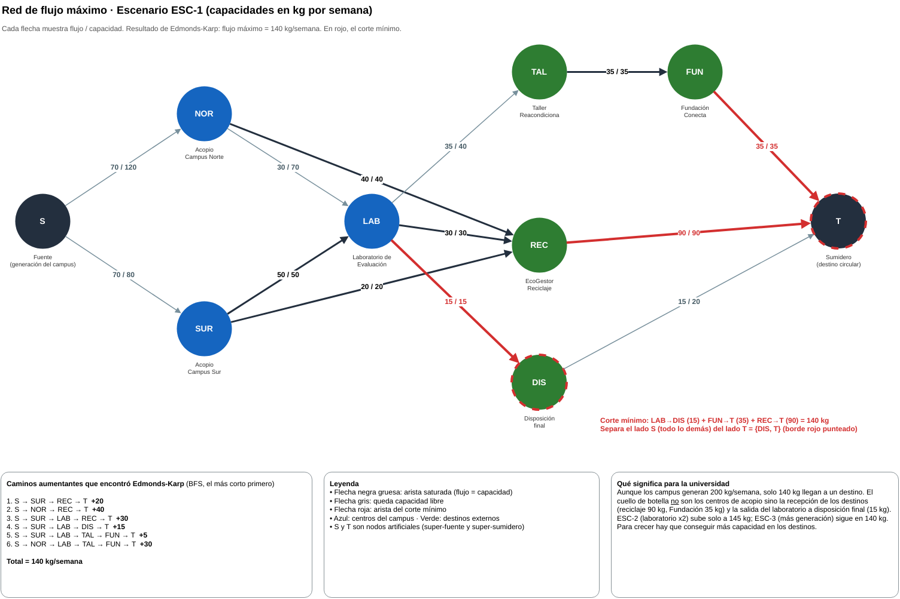

**Corte mínimo.** Es el conjunto de tramos que, si se cortan, separan S de T, y cuya capacidad total es la menor posible. El **teorema de flujo máximo y corte mínimo** dice que esa capacidad siempre es igual al flujo máximo. Aquí el corte es LAB→DIS (15) + FUN→T (35) + REC→T (90) = **140**. Por eso el corte señala dónde está el cuello de botella real.

> Esta red tiene **otro** corte de 140: NOR→REC + SUR→REC + LAB→REC + LAB→DIS + TAL→FUN. Los dos son correctos. El programa elige el más cercano a los destinos porque es el que mejor explica el problema.

**Qué le dice a la universidad.** El problema no son los centros de acopio sino la capacidad de **recepción de los destinos**. Duplicar el laboratorio (ESC-2) solo sube a 145 kg, y generar más (ESC-3) no cambia nada (140 kg). Para crecer hay que conseguir más convenios con recicladores o beneficiarios.

**Dónde corre en AWS.** No es un servicio aparte: es un módulo de la API en las EC2.
1. `GET /api/red/flujo-maximo?escenario=ESC-1` lee la red de las vistas `vw_red` y `vw_oferta_kg_centro`.
2. Ejecuta Edmonds-Karp (archivo `flujo_maximo.py`).
3. Guarda el resultado con `sp_guardar_resultado_flujo`. El trigger `tr_resultado_arista_rn05` verifica que ningún flujo supere su capacidad.

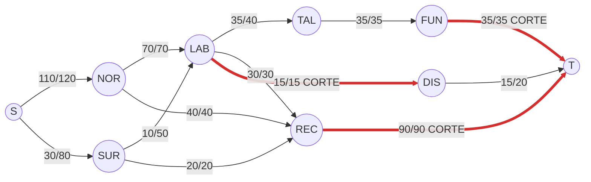

---

## 8. Políticas IAM de la EC2 (corregidas y explicadas)

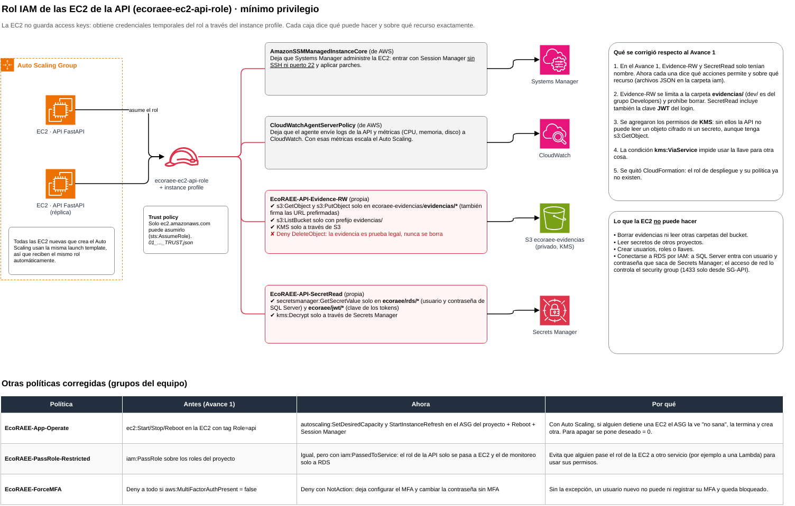

La EC2 **no** usa access keys. Recibe credenciales temporales del rol `ecoraee-ec2-api-role` a través del *instance profile*. El ASG lo pone en cada EC2 nueva desde la launch template.

| Archivo | Política | Qué permite y por qué |
|---|---|---|
| `01_ecoraee-ec2-api-role_TRUST.json` | Trust policy | Dice **quién** puede usar el rol: solo el servicio EC2 (`sts:AssumeRole`). Nadie más puede "ponerse" este rol. |
| (de AWS) | `AmazonSSMManagedInstanceCore` | Deja que Systems Manager administre la EC2. Se entra con Session Manager, **sin SSH ni puerto 22 abierto**, y se aplican parches. |
| (de AWS) | `CloudWatchAgentServerPolicy` | El agente envía los logs de la API y las métricas (CPU, memoria) a CloudWatch. Con esas métricas escala el Auto Scaling y suenan las alarmas. |
| `02_EcoRAEE-API-Evidence-RW.json` | Evidencias | `s3:GetObject` y `s3:PutObject` **solo en `ecoraee-evidencias/evidencias/*`** (con este permiso la API también firma las URL prefirmadas). `ListBucket` solo con ese prefijo. KMS solo a través de S3 (`kms:ViaService`), porque sin KMS no se puede leer un objeto cifrado. **Deny** a `DeleteObject`: la API nunca borra evidencias. |
| `03_EcoRAEE-API-SecretRead.json` | Secretos | `GetSecretValue` **solo** en `ecoraee/rds/*` (usuario de SQL Server) y `ecoraee/jwt/*` (clave de los tokens). `kms:Decrypt` solo a través de Secrets Manager. |

**Qué se corrigió:** en el Avance 1, Evidence-RW y SecretRead solo tenían nombre. Ahora cada una dice qué acciones permite y sobre qué recurso. Además se agregó KMS (sin él, la API recibe *AccessDenied* aunque tenga `s3:GetObject`), la clave JWT y la prohibición de borrar.

**Otras políticas relacionadas con EC2:**

| Archivo | Política | Corrección |
|---|---|---|
| `04_EcoRAEE-PassRole-Restricted.json` | PassRole | Se agregó `iam:PassedToService`. El rol de la API solo se puede pasar a EC2, y el de monitoreo solo a RDS. Sin esta condición, alguien podría pasar el rol a otro servicio y usar sus permisos. |
| `05_EcoRAEE-App-Operate.json` | Operar la app | Antes: `ec2:Start/Stop/Reboot`. Con Auto Scaling, detener una EC2 a mano no sirve: el ASG la ve "no sana", la termina y crea otra. Ahora se usa `autoscaling:SetDesiredCapacity` (para apagar todo se pone deseado = 0 y se ahorra en el laboratorio) y `StartInstanceRefresh` (renovar las EC2 con una nueva versión). Todo limitado al ASG con tag `Project=EcoRAEE`. Se mantiene `Reboot` y Session Manager solo en EC2 con tag `Role=api`. |
| `06_EcoRAEE-ForceMFA.json` | MFA obligatorio | Antes era "Deny a todo sin MFA", así que un usuario nuevo no podía ni registrar su MFA. Ahora usa `NotAction`: sin MFA solo se puede configurar el MFA y cambiar la contraseña. |
| `08_bucket-policy_ecoraee-evidencias.json` | Política del bucket | Solo HTTPS y nadie borra evidencias. |

> **Learner Lab:** si su cuenta es de AWS Academy, normalmente no se pueden crear roles ni usuarios IAM. Las EC2 usarían `LabInstanceProfile`. En ese caso, estas políticas se presentan como el **diseño objetivo** de mínimo privilegio, y hay que decir explícitamente qué se desplegó con `LabRole`.

**Antes de entregar,** peguen cada JSON en el editor de políticas de IAM. La consola los valida con *IAM Access Analyzer* y marca cualquier error o advertencia.

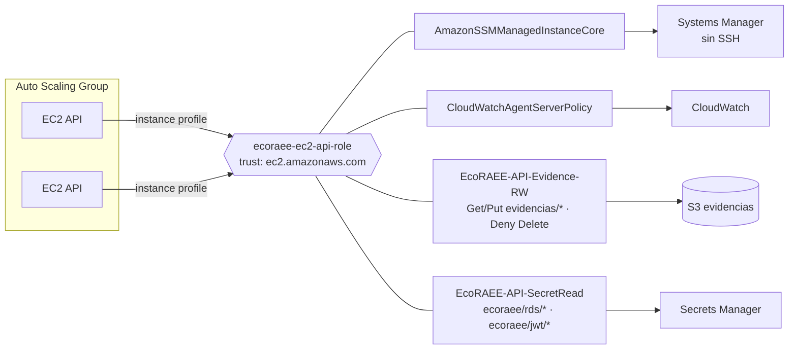
